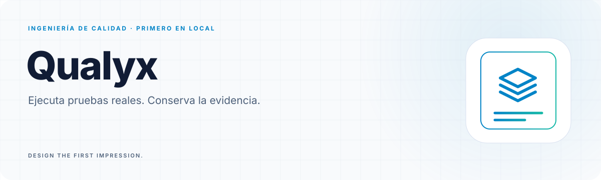

<a id="top"></a>

<!-- Generated by readme-builder; edit the JSON/content source. -->

<p align="center"><picture><source media="(prefers-color-scheme: dark)" srcset="assets/readme-builder/es/hero-dark.svg" /></picture></p>

<p align="center"><strong>Ejecuta pruebas reales. Conserva la evidencia.</strong></p>

<p align="center"><a href="#start"><picture><source media="(prefers-color-scheme: dark)" srcset="assets/readme-builder/kit/btn-ejecuta-tu-primera-prueba-outline-sm-dark.svg" /></picture></a>&nbsp;
<a href="#evidence"><picture><source media="(prefers-color-scheme: dark)" srcset="assets/readme-builder/kit/btn-resultados-que-puedes-revisar-outline-sm-dark.svg" /></picture></a>&nbsp;
<a href="#agents"><picture><source media="(prefers-color-scheme: dark)" srcset="assets/readme-builder/kit/btn-usalo-con-tu-agente-outline-sm-dark.svg" /></picture></a></p>

<p align="center"><a href="README.md"><picture><source media="(prefers-color-scheme: dark)" srcset="assets/readme-builder/kit/btn-english-outline-sm-dark.svg" /></picture></a>&nbsp;
<a href="README.es.md"><picture><source media="(prefers-color-scheme: dark)" srcset="assets/readme-builder/kit/btn-espanol-primary-sm-dark.svg" /></picture></a></p>

<a id="start"></a>

##  Ejecuta tu primera prueba

Qualyx descubre las pruebas de un proyecto, ejecuta sus herramientas nativas y conserva la evidencia. Úsalo desde la terminal, un agente MCP o una API compartida. **La ejecución determinista no necesita un modelo de IA.**

Los flujos principales están verificados con el [alcance documentado](docs/STATUS.md); el [plan completo sigue pendiente](docs/READINESS.md). CI valida Windows, Linux y macOS, incluidos navegadores reales y pruebas de instalación. Para un binario descargado, sigue la [instalación nativa](INSTALL.md).

Instala Git y Rust estable, además de las herramientas nativas de tu proyecto:

```sh
git clone https://github.com/robgallardof/qualyx.git
cd qualyx
cargo install --locked --path crates/qualyx-cli
qualyx doctor ruta/al/proyecto
qualyx discover ruta/al/proyecto
qualyx test ruta/al/proyecto
qualyx report ruta/al/proyecto
```

Para un ejemplo real pequeño, instala Python y pytest y ejecuta `qualyx test fixtures/python/passing`. El proyecto `fixtures/python/failing` falla intencionalmente. Las pruebas ejecutan código del proyecto: usa repositorios de confianza.

Códigos de salida: **0** aprobado · **1** fallos · **2** sin demostrar. Un proyecto vacío nunca aparece aprobado. El [flujo de paquetes](https://github.com/robgallardof/qualyx/actions/workflows/release.yml) genera archivos nativos y checksums; esto no implica una versión pública publicada.

<p align="center"></p>

<a id="evidence"></a>

##  Resultados que puedes revisar

Cada ejecución escribe en `.qualyx/runs/<run-id>/`: `manifest.json`, `report.md`, reportes nativos y logs. El manifiesto registra comandos, versiones, commit, códigos de salida y el detalle disponible de las pruebas. `.qualyx/` se excluye a sí misma de Git.

```sh
qualyx report ruta/al/proyecto --list
qualyx report ruta/al/proyecto --run <run-id> --format json
qualyx report ruta/al/proyecto --format markdown
```

| Ecosistema | Runner nativo | Evidencia |
|---|---|---|
| Rust | `cargo test` | Pruebas individuales de libtest |
| .NET | `dotnet test` | Pruebas individuales de TRX |
| Node | `npm test` → `node --test` | Pruebas individuales de JUnit |
| Node, otros runners | `npm test` | Solo código de salida, indicado en el reporte |
| Python | `python -m pytest` | Pruebas individuales de JUnit |

Los adaptadores opcionales cubren [navegadores y accesibilidad](docs/m4/browsers.md), [carga y seguridad](docs/m5/assurance.md), y [mutación, contratos y servicios](docs/m6/quality.md). Requieren sus herramientas y permisos; una ejecución normal no activa todos los adaptadores.

Las [auditorías de seguridad](docs/m5/security-audit.md) incluyen cobertura explícita, resultados de cada escáner y una skill reutilizable. Un escaneo incompleto es inconcluso; los hallazgos necesitan revisión antes de confirmarse.

<p align="center"></p>

<a id="agents"></a>

##  Úsalo con tu agente

Genera una configuración, revísala y agrégala a tu cliente:

```sh
qualyx mcp-config codex --root /ruta/absoluta/al/proyecto
```

El servidor se inicia con `qualyx mcp --root /ruta/absoluta/al/proyecto`. MCP permite descubrir proyectos, ejecutar pruebas y consultar evidencia. Generar una configuración no demuestra compatibilidad: consulta versiones verificadas y clientes pendientes en la [matriz de clientes](docs/m2/clients.md), incluidos Claude Code, Codex, Cursor y OpenCode.

Las funciones asistidas por IA son opcionales. Mantén los permisos explícitos: ejecutar pruebas implica ejecutar código del proyecto.

<p align="center"></p>

<a id="team"></a>

##  Comparte la ejecución con tu equipo

La CLI y MCP usan SQLite por defecto. El modo equipo agrega API HTTP autenticada, panel de lectura, trabajos en PostgreSQL, trabajadores separados y almacenamiento opcional de evidencia compatible con S3.

| Modo | Para qué sirve | Requisitos |
|---|---|---|
| CLI / MCP local | Un proyecto, evidencia local | Herramientas nativas |
| API local | Hasta cuatro ejecuciones simultáneas | Token y raíces de proyecto permitidas |
| API de equipo | Cola persistente y trabajadores independientes | PostgreSQL; S3 opcional |

### Revisa resultados en la consola

`qualyx serve` también sirve una consola web de solo lectura en `/`: historial de ejecuciones, conteo de pruebas correctas y fallidas, búsqueda, filtros y el reporte de cada ejecución. Está hecha con Next.js y shadcn/ui, tiene tema claro y oscuro y está en español e inglés. Va incluida dentro del binario `qualyx`, así que no necesitas un servidor de Node.js. Nunca inicia ni cancela ejecuciones: eso lo hace tu terminal o tu agente MCP.

```sh
export QUALYX_API_TOKEN="$(openssl rand -hex 24)"   # 32+ caracteres imprimibles
qualyx serve --root /ruta/a/proyectos               # http://127.0.0.1:7878
```

Abre `http://127.0.0.1:7878`, escribe la ruta de un proyecto dentro de `--root` y el token. El token solo vive en la memoria de esa pestaña.

La [guía bilingüe de equipo](docs/m7/team.md) incluye Compose, credenciales, SDK de Python, cancelación, respaldos y recuperación. Léela antes de desplegar `deploy/team/compose.yaml`.

Cada trabajador procesa un trabajo a la vez. La cola admite hasta 64 trabajos pendientes/en ejecución. Si vence la sesión de un trabajador, el trabajo falla sin repetir automáticamente sus efectos externos. Un trabajo terminado no significa pruebas aprobadas: revisa `manifest.status`.

**Límite del despliegue:** solo copias de proyectos de confianza. La imagen incluye Python/pytest; otros ecosistemas necesitan una imagen propia. No incluye RBAC por usuario, aislamiento multiusuario hostil, TLS remoto para PostgreSQL, alta disponibilidad, versiones firmadas ni SBOM formal. Lee [SECURITY.md](SECURITY.md) antes de exponerlo remotamente.

<p align="center"></p>

<a id="develop"></a>

##  Explora y contribuye

- [Estado](docs/STATUS.md): verificaciones ejecutadas, evidencia y límites.
- [Planeación](docs/PLANNING.md) y [prompt maestro](docs/MASTER_PROMPT.md): arquitectura e hitos.
- [Matriz de integraciones](docs/m0/integration-matrix.md), [modelo de amenazas](docs/m0/threat-model.md) y [decisiones](docs/adr/).
- [CONTRIBUTING.md](CONTRIBUTING.md) y [AGENTS.md](AGENTS.md): reglas para contribuir.

Las pruebas completas necesitan Rust, .NET 10, Node 24 y Python con pytest. Las de navegadores y servicios tienen requisitos adicionales. Las pruebas de carga, DAST y los destinos de producción requieren permiso explícito.

```sh
cargo fmt --all --check
cargo clippy --workspace --all-targets -- -D warnings
cargo test --workspace --locked
```

La consola vive en `web/dashboard` (export estático de Next.js). Su build se versiona en `crates/qualyx-api/dashboard`, así que `cargo build` nunca necesita Node; CI la reconstruye y falla si no coincide. Después de cambiarla:

```sh
cd web/dashboard && npm ci && npm run typecheck && npm test && npm run build
cargo test -p qualyx-cli --test team dashboard_recovers -- --ignored   # Chromium real
```

Este README usa [Readme Builder](https://github.com/robgallardof/readme-builder). Edita `readme.json` y `docs/readme/content/` y sigue las [instrucciones de regeneración](docs/readme/README.md).

Doble licencia: [MIT](LICENSE-MIT) o [Apache-2.0](LICENSE-APACHE), a tu elección. [Avisos de los recursos del README](docs/readme/THIRD-PARTY-NOTICES.md).

<p align="center"><a href="#top"><picture><source media="(prefers-color-scheme: dark)" srcset="assets/readme-builder/kit/btn-volver-al-inicio-outline-sm-dark.svg" /></picture></a></p>

<!-- readme-builder:signature:start -->
<p align="center"><picture><source media="(prefers-color-scheme: dark)" srcset="assets/readme-builder/es/footer-dark.svg" /></picture></p>
<!-- readme-builder:signature:end -->
