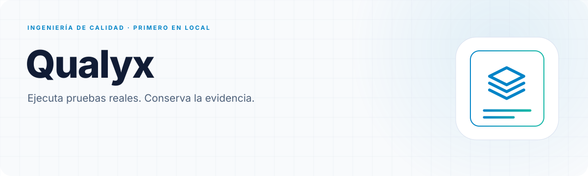
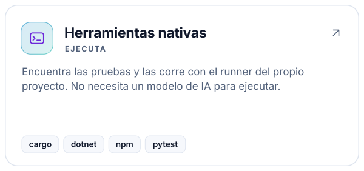
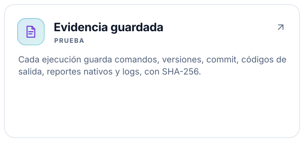
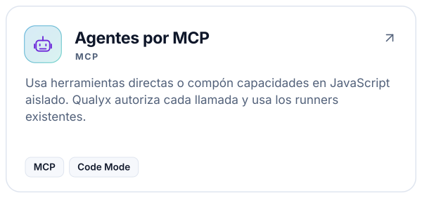
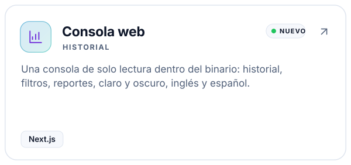
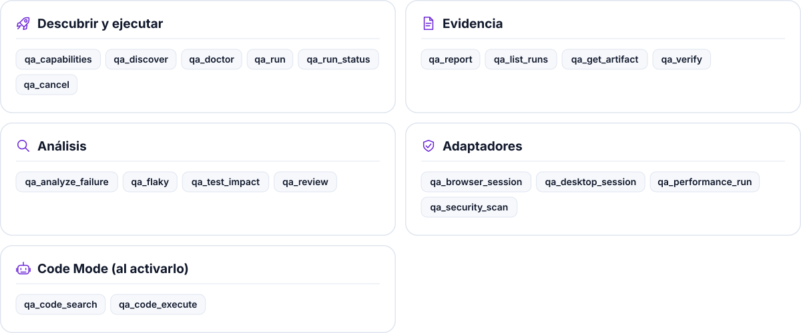
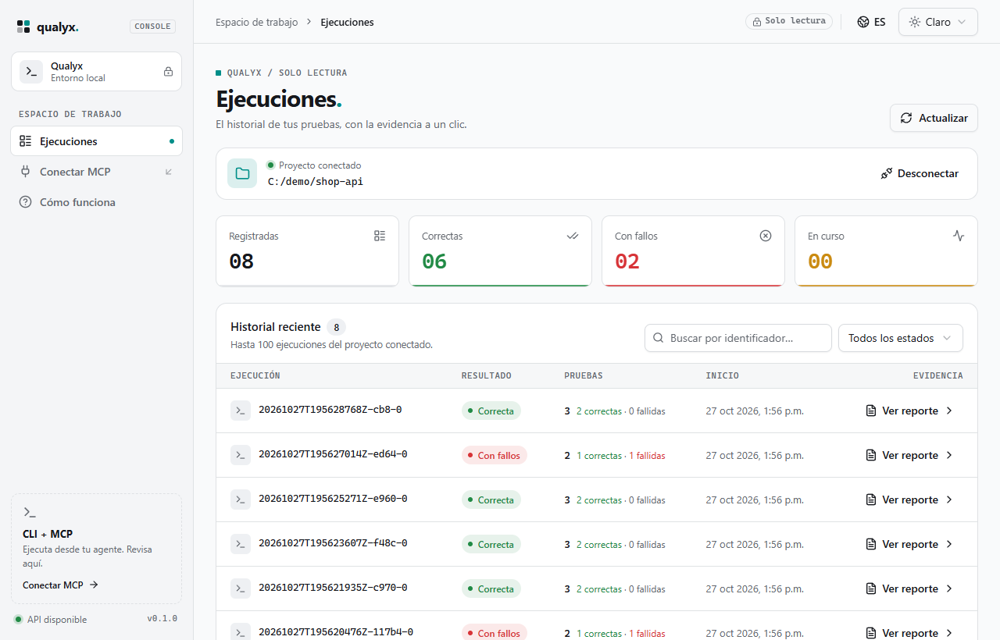
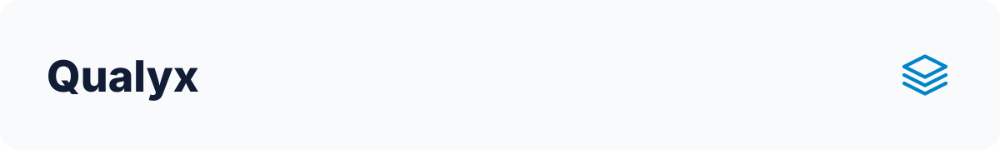

<a id="top"></a>

<!-- Generated by readme-builder; edit the JSON/content source. -->

<p align="center"><picture><source media="(prefers-color-scheme: dark)" srcset="assets/readme-builder/es/hero-dark.svg" /></picture></p>

<p align="center"><strong>Ejecuta pruebas reales. Conserva la evidencia.</strong></p>

<p align="center"><a href="#start"><picture><source media="(prefers-color-scheme: dark)" srcset="assets/readme-builder/kit/btn-ejecuta-tu-primera-prueba-outline-sm-dark.svg" /></picture></a>&nbsp;
<a href="#evidence"><picture><source media="(prefers-color-scheme: dark)" srcset="assets/readme-builder/kit/btn-resultados-que-puedes-revisar-outline-sm-dark.svg" /></picture></a>&nbsp;
<a href="#agents"><picture><source media="(prefers-color-scheme: dark)" srcset="assets/readme-builder/kit/btn-instalacion-retirada-y-compatibilidad-outline-sm-dark.svg" /></picture></a></p>

<p align="center"><a href="README.md"><picture><source media="(prefers-color-scheme: dark)" srcset="assets/readme-builder/kit/btn-english-outline-sm-dark.svg" /></picture></a>&nbsp;
<a href="README.es.md"><picture><source media="(prefers-color-scheme: dark)" srcset="assets/readme-builder/kit/btn-espanol-primary-sm-dark.svg" /></picture></a></p>

<a id="start"></a>

##  Ejecuta tu primera prueba

Qualyx descubre las pruebas de un proyecto, ejecuta sus herramientas nativas y conserva la evidencia. Úsalo desde la terminal, un agente MCP o una API compartida, y revisa los resultados en una consola web. **La ejecución determinista no necesita un modelo de IA.**

<!-- kit:why -->
<p align="center"><a href="#evidence"><picture><source media="(prefers-color-scheme: dark)" srcset="assets/readme-builder/kit/why-es-01-dark.svg" /></picture></a><a href="#evidence"><picture><source media="(prefers-color-scheme: dark)" srcset="assets/readme-builder/kit/why-es-02-dark.svg" /></picture></a><a href="#agents"><picture><source media="(prefers-color-scheme: dark)" srcset="assets/readme-builder/kit/why-es-03-dark.svg" /></picture></a><a href="#console"><picture><source media="(prefers-color-scheme: dark)" srcset="assets/readme-builder/kit/why-es-04-dark.svg" /></picture></a></p>
<!-- /kit:why -->

Los flujos principales están verificados con el [alcance documentado](docs/STATUS.md); el [plan completo sigue pendiente](docs/READINESS.md). CI valida Windows, Linux y macOS, incluidos navegadores reales y pruebas de instalación. Para un binario descargado, sigue la [instalación nativa](INSTALL.md).

Instala Git y Rust estable, además de las herramientas nativas de tu proyecto:

```sh
git clone https://github.com/robgallardof/qualyx.git
cd qualyx
cargo install --locked --path crates/qualyx-cli
qualyx doctor ruta/al/proyecto
qualyx discover ruta/al/proyecto
qualyx test ruta/al/proyecto
qualyx report ruta/al/proyecto
```

<p align="center"><picture><source media="(prefers-color-scheme: dark)" srcset="assets/readme/diagrams/first-check-es-dark.svg" /></picture></p>

Para un ejemplo real pequeño, instala Python y pytest y ejecuta `qualyx test fixtures/python/passing`. El proyecto `fixtures/python/failing` falla intencionalmente. Las pruebas ejecutan código del proyecto: usa repositorios de confianza.

| Código de salida | Significado |
|---|---|
| `0` | Aprobado |
| `1` | Falló al menos una prueba |
| `2` | Nada demostrado: un error o un resultado inconcluso, como no encontrar pruebas |

Un proyecto vacío nunca aparece aprobado. El [flujo de paquetes](https://github.com/robgallardof/qualyx/actions/workflows/release.yml) genera archivos nativos y checksums; esto no implica una versión pública publicada.

<p align="center"></p>

<a id="evidence"></a>

##  Resultados que puedes revisar

Cada ejecución escribe en `.qualyx/runs/<run-id>/`: `manifest.json`, `report.md`, reportes nativos y logs. El manifiesto registra comandos, versiones, commit, códigos de salida y el detalle disponible de las pruebas. `.qualyx/` se excluye a sí misma de Git.

```sh
qualyx report ruta/al/proyecto --list
qualyx report ruta/al/proyecto --run <run-id> --format json
qualyx report ruta/al/proyecto --format markdown
```

| Ecosistema | Runner nativo | Evidencia |
|---|---|---|
| Rust | `cargo test` | Pruebas individuales de libtest |
| .NET | `dotnet test` | Pruebas individuales de TRX |
| Node | `npm test` → `node --test` | Pruebas individuales de JUnit |
| Node, otros runners | `npm test` | Solo código de salida, indicado en el reporte |
| Python | `python -m pytest` | Pruebas individuales de JUnit |

Los adaptadores opcionales cubren [navegadores y accesibilidad](docs/m4/browsers.md), [carga y seguridad](docs/m5/assurance.md), y [mutación, contratos y servicios](docs/m6/quality.md). Requieren sus herramientas y permisos; una ejecución normal no activa todos los adaptadores.

Las [auditorías de seguridad](docs/m5/security-audit.md) incluyen cobertura explícita, resultados de cada escáner y una skill reutilizable. Un escaneo incompleto es inconcluso; los hallazgos necesitan revisión antes de confirmarse.

<p align="center"></p>

<a id="agents"></a>

##  Instalación, retirada y compatibilidad

Qualyx corre como servidor MCP local (`qualyx mcp --root <dir>`, stdio). `qualyx mcp-config <cliente>` imprime la entrada exacta para tu cliente; no escribe nada por ti, así que puedes revisarla antes de agregarla.

| Cliente | Imprimir la entrada | Dónde va | Quitarla | Probado |
|---|---|---|---|---|
| Claude Code | `qualyx mcp-config claude --root <dir>` | `.mcp.json`, o `claude mcp add qualyx -- …` | `claude mcp remove qualyx` | Verificado en 2.1.311 |
| Codex CLI | `qualyx mcp-config codex --root <dir>` | `~/.codex/config.toml` | Borra la tabla `[mcp_servers.qualyx]` | Verificado en 0.164.0 |
| OpenCode | `qualyx mcp-config opencode --root <dir>` | `opencode.json` | Borra `mcp.qualyx` | Solo se genera, sin probar |
| Cursor | `qualyx mcp-config cursor --root <dir>` | `.cursor/mcp.json` | Borra `mcpServers.qualyx` | Solo se genera, sin probar |
| VS Code | `qualyx mcp-config vscode --root <dir>` | `.vscode/mcp.json` | Borra `servers.qualyx` | Solo se genera, sin probar |
| Cualquier cliente MCP | `qualyx mcp-config generic --root <dir>` | El `mcpServers` del cliente | Borra `mcpServers.qualyx` | Pruebas JSON-RPC en CI |

```sh
qualyx mcp-config claude --root /ruta/absoluta/al/proyecto   # revisa y pega o corre el comando impreso
claude mcp list                                              # qualyx debe aparecer conectado
```

Pasa `--root` varias veces para permitir varios proyectos. Las herramientas de lectura están marcadas como de solo lectura: los clientes que respetan esas marcas pueden aprobarlas solos y pedir permiso antes de `qa_run`, que ejecuta el código del proyecto.

El [Code Mode autoalojado](docs/code-mode.md) opcional permite descubrir capacidades y componer llamadas mediante JavaScript aislado sobre los mismos trabajos. Está desactivado por defecto, requiere un motor local de contenedores Linux y solo permite lectura hasta que el administrador apruebe capacidades de escritura. Las herramientas directas siguen disponibles.

Para instalar o actualizar desde este repositorio, ejecuta `cargo install --path crates/qualyx-cli --locked --force` y construye el contenedor con `docker build -f deploy/code/Dockerfile -t qualyx-code-sandbox:local .`. Apunta la entrada MCP al binario instalado (`~/.cargo/bin/qualyx`, o `qualyx.exe` en Windows), en lugar de `target/debug`.

Agrega estas variables al campo `env` de esa entrada MCP y reinicia el servidor en tu cliente:

```json
{
  "QUALYX_CODE_MODE": "1",
  "QUALYX_CODE_ONLY": "1",
  "QUALYX_CODE_IMAGE": "qualyx-code-sandbox:local"
}
```

Esto anuncia `qa_code_search` y `qa_code_execute`. Para aprobar el envío y la cancelación de pruebas en los directorios configurados, el administrador puede agregar `QUALYX_CODE_APPROVALS=tests.run,tests.cancel`. Omite `QUALYX_CODE_ONLY` para conservar las herramientas directas en la misma sesión. Codex admite `.codex/config.toml` en proyectos de confianza; conserva las rutas del equipo y los permisos en local. Consulta la [configuración y los ejemplos](docs/code-mode.md).

<p align="center"><picture><source media="(prefers-color-scheme: dark)" srcset="assets/readme/diagrams/code-mode-es-dark.svg" /></picture></p>

<!-- kit:tools -->
<p align="center"><picture><source media="(prefers-color-scheme: dark)" srcset="assets/readme-builder/kit/tools-es-dark.svg" /></picture></p>
<!-- /kit:tools -->

El repositorio incluye una [skill de auditoría de seguridad](.agents/skills/qualyx-security-audit/SKILL.md) que detectan los clientes que leen `.agents/skills`. No se edita ninguna configuración global de agentes. Las funciones con IA siguen siendo opcionales.

<!-- kit:agent-links -->
<p align="center"><a href="docs/m2/clients.md"><picture><source media="(prefers-color-scheme: dark)" srcset="assets/readme-builder/kit/agent-links-es-01-dark.svg" /></picture></a>&nbsp;
<a href="docs/code-mode.md"><picture><source media="(prefers-color-scheme: dark)" srcset="assets/readme-builder/kit/agent-links-es-02-dark.svg" /></picture></a>&nbsp;
<a href="docs/m5/security-audit.md"><picture><source media="(prefers-color-scheme: dark)" srcset="assets/readme-builder/kit/agent-links-es-03-dark.svg" /></picture></a>&nbsp;
<a href="docs/STATUS.md"><picture><source media="(prefers-color-scheme: dark)" srcset="assets/readme-builder/kit/agent-links-es-04-dark.svg" /></picture></a></p>
<!-- /kit:agent-links -->

<p align="center"></p>

<a id="console"></a>

##  Mira tus ejecuciones en la consola

Las pruebas se ejecutan desde tu terminal o tu agente. Para revisarlas después, `qualyx serve` te da una pequeña consola web:

<p align="center"><picture><source media="(prefers-color-scheme: dark)" srcset="assets/screenshots/console-es-dark.png" /></picture></p>

- **El historial de un vistazo:** cuántas ejecuciones pasaron, fallaron o siguen en curso, con búsqueda por identificador y filtro por estado.
- **La evidencia, no un resumen:** abre el `report.md` de cualquier ejecución tal como lo escribió Qualyx.
- **Claro u oscuro, español o inglés:** sigue a tu sistema y a tu navegador, y puedes cambiar ambos.
- **Solo lectura a propósito:** nunca inicia ni cancela nada, así que dejarla abierta no tiene riesgo.

```sh
export QUALYX_API_TOKEN="$(openssl rand -hex 24)"   # 32+ caracteres imprimibles
qualyx serve --root /ruta/a/proyectos               # luego abre http://127.0.0.1:7878
```

Escribe la ruta de un proyecto dentro de `--root` y el token. El token solo vive en esa pestaña y se borra al recargar. La consola viene dentro del binario `qualyx`, así que no hay nada más que instalar ni levantar: ni Node.js ni otro servidor.

<p align="center"></p>

<a id="team"></a>

##  Comparte la ejecución con tu equipo

La CLI y MCP usan SQLite por defecto. El modo equipo agrega API HTTP autenticada, la [consola](#console) de solo lectura, trabajos en PostgreSQL, trabajadores separados y almacenamiento opcional de evidencia compatible con S3.

| Modo | Para qué sirve | Requisitos |
|---|---|---|
| CLI / MCP local | Un proyecto, evidencia local | Herramientas nativas |
| API local | Hasta cuatro ejecuciones simultáneas | Token y raíces de proyecto permitidas |
| API de equipo | Cola persistente y trabajadores independientes | PostgreSQL; S3 opcional |

La [guía bilingüe de equipo](docs/m7/team.md) incluye Compose, credenciales, SDK de Python, cancelación, respaldos y recuperación. Léela antes de desplegar `deploy/team/compose.yaml`.

Cada trabajador procesa un trabajo a la vez. La cola admite hasta 64 trabajos pendientes/en ejecución. Si vence la sesión de un trabajador, el trabajo falla sin repetir automáticamente sus efectos externos. Un trabajo terminado no significa pruebas aprobadas: revisa `manifest.status`.

**Límite del despliegue:** solo copias de proyectos de confianza. La imagen incluye Python/pytest; otros ecosistemas necesitan una imagen propia. No incluye RBAC por usuario, aislamiento multiusuario hostil, TLS remoto para PostgreSQL, alta disponibilidad, versiones firmadas ni SBOM formal. Lee [SECURITY.md](SECURITY.md) antes de exponerlo remotamente.

<p align="center"></p>

<a id="develop"></a>

##  Explora y contribuye

- [Estado](docs/STATUS.md): verificaciones ejecutadas, evidencia y límites.
- [Planeación](docs/PLANNING.md) y [prompt maestro](docs/MASTER_PROMPT.md): arquitectura e hitos.
- [Matriz de integraciones](docs/m0/integration-matrix.md), [modelo de amenazas](docs/m0/threat-model.md) y [decisiones](docs/adr/).
- [CONTRIBUTING.md](CONTRIBUTING.md) y [AGENTS.md](AGENTS.md): reglas para contribuir.

Las pruebas completas necesitan Rust, .NET 10, Node 24 y Python con pytest. Las de navegadores y servicios tienen requisitos adicionales. Las pruebas de carga, DAST y los destinos de producción requieren permiso explícito.

```sh
cargo fmt --all --check
cargo clippy --workspace --all-targets -- -D warnings
cargo test --workspace --locked
```

La consola vive en `web/dashboard` (export estático de Next.js). Su build se versiona en `crates/qualyx-api/dashboard`, así que `cargo build` nunca necesita Node; CI la reconstruye y falla si no coincide. Después de cambiarla:

```sh
cd web/dashboard && npm ci && npm run typecheck && npm test && npm run build
cargo test -p qualyx-cli --test team dashboard_recovers -- --ignored   # Chromium real
```

Este README usa [Readme Builder](https://github.com/robgallardof/readme-builder). Edita `readme.json` y `docs/readme/content/` y sigue las [instrucciones de regeneración](docs/readme/README.md).

Doble licencia: [MIT](LICENSE-MIT) o [Apache-2.0](LICENSE-APACHE), a tu elección. [Avisos de los recursos del README](docs/readme/THIRD-PARTY-NOTICES.md).

<p align="center"><a href="#top"><picture><source media="(prefers-color-scheme: dark)" srcset="assets/readme-builder/kit/btn-volver-al-inicio-outline-sm-dark.svg" /></picture></a></p>

<!-- readme-builder:signature:start -->
<p align="center"><picture><source media="(prefers-color-scheme: dark)" srcset="assets/readme-builder/es/footer-dark.svg" /></picture></p>
<!-- readme-builder:signature:end -->
