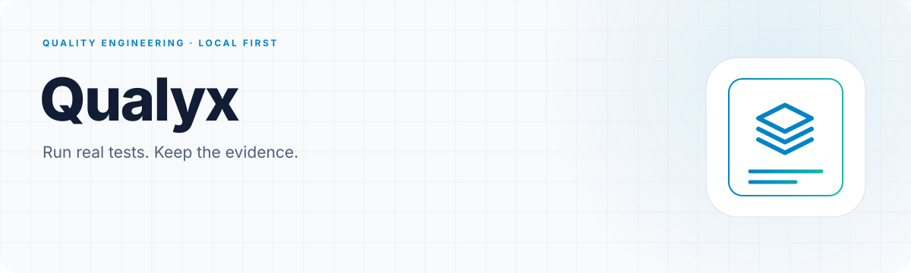
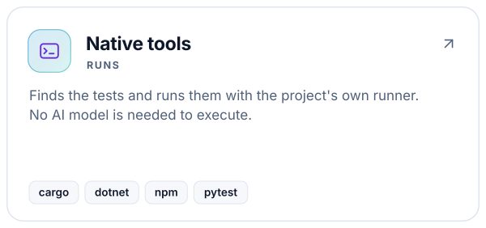
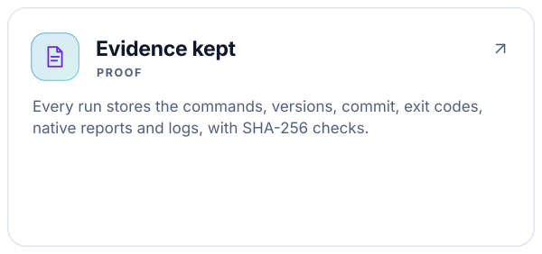
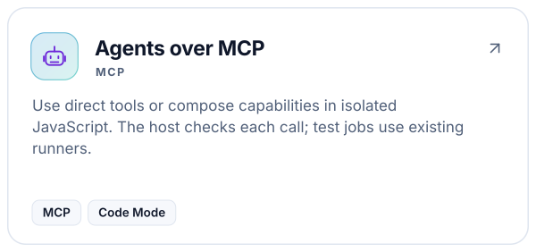
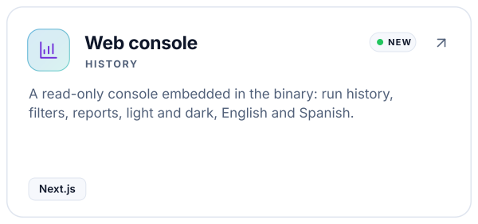
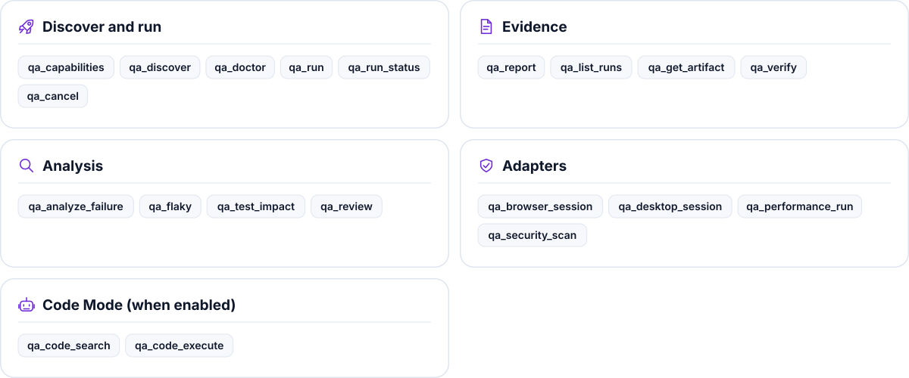
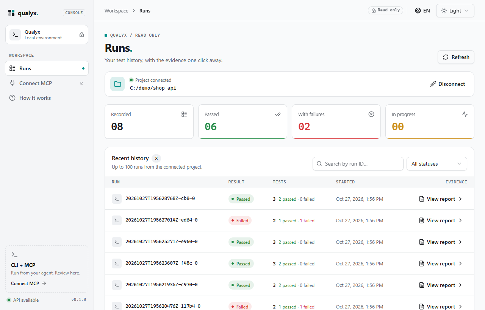
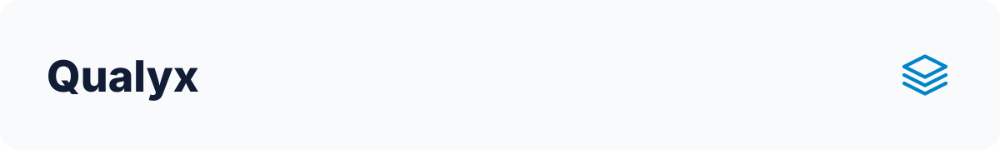

<a id="top"></a>

<!-- Generated by readme-builder; edit the JSON/content source. -->

<p align="center"><picture><source media="(prefers-color-scheme: dark)" srcset="assets/readme-builder/en/hero-dark.svg" /></picture></p>

<p align="center"><strong>Run real tests. Keep the evidence.</strong></p>

<p align="center"><a href="#start"><picture><source media="(prefers-color-scheme: dark)" srcset="assets/readme-builder/kit/btn-run-your-first-check-outline-sm-dark.svg" /></picture></a>&nbsp;
<a href="#evidence"><picture><source media="(prefers-color-scheme: dark)" srcset="assets/readme-builder/kit/btn-results-you-can-inspect-outline-sm-dark.svg" /></picture></a>&nbsp;
<a href="#agents"><picture><source media="(prefers-color-scheme: dark)" srcset="assets/readme-builder/kit/btn-agent-setup-removal-and-compatibility-outline-sm-dark.svg" /></picture></a></p>

<p align="center"><a href="README.md"><picture><source media="(prefers-color-scheme: dark)" srcset="assets/readme-builder/kit/btn-english-primary-sm-dark.svg" /></picture></a>&nbsp;
<a href="README.es.md"><picture><source media="(prefers-color-scheme: dark)" srcset="assets/readme-builder/kit/btn-espanol-outline-sm-dark.svg" /></picture></a></p>

<a id="start"></a>

##  Run your first check

Qualyx discovers a project's tests, runs its native tools and preserves the evidence. Use it from a terminal, an MCP agent or a shared API, and look back at the results in a web console. **Deterministic execution needs no AI model.**

<!-- kit:why -->
<p align="center"><a href="#evidence"><picture><source media="(prefers-color-scheme: dark)" srcset="assets/readme-builder/kit/why-en-01-dark.svg" /></picture></a><a href="#evidence"><picture><source media="(prefers-color-scheme: dark)" srcset="assets/readme-builder/kit/why-en-02-dark.svg" /></picture></a><a href="#agents"><picture><source media="(prefers-color-scheme: dark)" srcset="assets/readme-builder/kit/why-en-03-dark.svg" /></picture></a><a href="#console"><picture><source media="(prefers-color-scheme: dark)" srcset="assets/readme-builder/kit/why-en-04-dark.svg" /></picture></a></p>
<!-- /kit:why -->

Core workflows are verified within the [documented scope](docs/STATUS.md); the [full roadmap remains incomplete](docs/READINESS.md). CI validates Windows, Linux and macOS, including real browsers and installation smoke tests. For a downloaded binary, follow [native installation](INSTALL.md).

Install Git and stable Rust, plus the native toolchain for your project:

```sh
git clone https://github.com/robgallardof/qualyx.git
cd qualyx
cargo install --locked --path crates/qualyx-cli
qualyx doctor path/to/project
qualyx discover path/to/project
qualyx test path/to/project
qualyx report path/to/project
```

<p align="center"><picture><source media="(prefers-color-scheme: dark)" srcset="assets/readme/diagrams/first-check-en-dark.svg" /></picture></p>

For a small real example, install Python and pytest, then run `qualyx test fixtures/python/passing`. The companion `fixtures/python/failing` deliberately fails. Tests execute project code: use repositories you trust.

| Exit code | Meaning |
|---|---|
| `0` | Passed |
| `1` | At least one test failed |
| `2` | Nothing proven: an error, or an inconclusive result such as finding no tests |

An empty project is never green. Native archives and checksums are built by the [package workflow](https://github.com/robgallardof/qualyx/actions/workflows/release.yml); this does not imply a published release.

<p align="center"></p>

<a id="evidence"></a>

##  Results you can inspect

Every run writes `.qualyx/runs/<run-id>/`: `manifest.json`, `report.md`, native reports and logs. The manifest records commands, tool versions, commit, exit codes and available test details. `.qualyx/` ignores itself in Git.

```sh
qualyx report path/to/project --list
qualyx report path/to/project --run <run-id> --format json
qualyx report path/to/project --format markdown
```

| Ecosystem | Native runner | Evidence |
|---|---|---|
| Rust | `cargo test` | Individual tests from libtest |
| .NET | `dotnet test` | Individual tests from TRX |
| Node | `npm test` → `node --test` | Individual tests from JUnit |
| Node, other runners | `npm test` | Exit code only, explicitly reported |
| Python | `python -m pytest` | Individual tests from JUnit |

Optional adapters cover [browsers and accessibility](docs/m4/browsers.md), [load and security](docs/m5/assurance.md), and [mutation, contracts and services](docs/m6/quality.md). They require their own tools and permissions; a default run does not execute every adapter.

[Security audits](docs/m5/security-audit.md) include explicit scanner coverage, execution receipts and a reusable agent skill. Missing or failed scans are inconclusive; scanner findings remain candidates until reviewed.

<p align="center"></p>

<a id="agents"></a>

##  Agent setup, removal and compatibility

Qualyx runs as a local MCP server (`qualyx mcp --root <dir>`, stdio). `qualyx mcp-config <client>` prints the exact entry for your client; nothing is written for you, so you can review it before adding it.

| Client | Print the entry | Where it goes | Remove it | Tested |
|---|---|---|---|---|
| Claude Code | `qualyx mcp-config claude --root <dir>` | `.mcp.json`, or `claude mcp add qualyx -- …` | `claude mcp remove qualyx` | Verified on 2.1.311 |
| Codex CLI | `qualyx mcp-config codex --root <dir>` | `~/.codex/config.toml` | Delete the `[mcp_servers.qualyx]` table | Verified on 0.164.0 |
| OpenCode | `qualyx mcp-config opencode --root <dir>` | `opencode.json` | Delete `mcp.qualyx` | Snippet only, not run |
| Cursor | `qualyx mcp-config cursor --root <dir>` | `.cursor/mcp.json` | Delete `mcpServers.qualyx` | Snippet only, not run |
| VS Code | `qualyx mcp-config vscode --root <dir>` | `.vscode/mcp.json` | Delete `servers.qualyx` | Snippet only, not run |
| Any MCP client | `qualyx mcp-config generic --root <dir>` | The client's `mcpServers` | Delete `mcpServers.qualyx` | Raw JSON-RPC tests in CI |

```sh
qualyx mcp-config claude --root /absolute/path/to/project   # review, then paste or run the printed command
claude mcp list                                             # qualyx should show as connected
```

Pass `--root` more than once to allow several projects. Read tools are marked read-only, so clients that honor annotations can approve them on their own and ask before `qa_run`, which executes the project's code.

Optional [self-hosted Code Mode](docs/code-mode.md) adds progressive capability search and isolated JavaScript composition over the same jobs. It is disabled by default, requires a local Linux container engine, and grants read-only access until the operator explicitly approves write capabilities. Direct tools remain available.

To install or update from this checkout, run `cargo install --path crates/qualyx-cli --locked --force`, then build the sandbox with `docker build -f deploy/code/Dockerfile -t qualyx-code-sandbox:local .`. Point your MCP entry at the installed binary (`~/.cargo/bin/qualyx`, or `qualyx.exe` on Windows), rather than `target/debug`.

Add these variables to that MCP entry's `env`, then restart the server in your client:

```json
{
  "QUALYX_CODE_MODE": "1",
  "QUALYX_CODE_ONLY": "1",
  "QUALYX_CODE_IMAGE": "qualyx-code-sandbox:local"
}
```

This advertises `qa_code_search` and `qa_code_execute`. To approve test submission and cancellation for the configured roots, the operator can also set `QUALYX_CODE_APPROVALS=tests.run,tests.cancel`. Leave `QUALYX_CODE_ONLY` unset to keep direct tools in the same session. Codex supports a trusted project's `.codex/config.toml`; keep machine-specific paths and approvals local. See the [configuration and examples](docs/code-mode.md).

<p align="center"><picture><source media="(prefers-color-scheme: dark)" srcset="assets/readme/diagrams/code-mode-en-dark.svg" /></picture></p>

<!-- kit:tools -->
<p align="center"><picture><source media="(prefers-color-scheme: dark)" srcset="assets/readme-builder/kit/tools-en-dark.svg" /></picture></p>
<!-- /kit:tools -->

The repository also ships a [security audit skill](.agents/skills/qualyx-security-audit/SKILL.md) that clients reading `.agents/skills` pick up. No global agent configuration is edited. AI-assisted features stay optional.

<!-- kit:agent-links -->
<p align="center"><a href="docs/m2/clients.md"><picture><source media="(prefers-color-scheme: dark)" srcset="assets/readme-builder/kit/agent-links-en-01-dark.svg" /></picture></a>&nbsp;
<a href="docs/code-mode.md"><picture><source media="(prefers-color-scheme: dark)" srcset="assets/readme-builder/kit/agent-links-en-02-dark.svg" /></picture></a>&nbsp;
<a href="docs/m5/security-audit.md"><picture><source media="(prefers-color-scheme: dark)" srcset="assets/readme-builder/kit/agent-links-en-03-dark.svg" /></picture></a>&nbsp;
<a href="docs/STATUS.md"><picture><source media="(prefers-color-scheme: dark)" srcset="assets/readme-builder/kit/agent-links-en-04-dark.svg" /></picture></a></p>
<!-- /kit:agent-links -->

<p align="center"></p>

<a id="console"></a>

##  See your runs in the console

Tests run from your terminal or your agent. To look back at them, `qualyx serve` gives you a small web console:

<p align="center"><picture><source media="(prefers-color-scheme: dark)" srcset="assets/screenshots/console-en-dark.png" /></picture></p>

- **History at a glance:** how many runs passed, failed or are still going, with search by run ID and a status filter.
- **The evidence, not a summary:** open any run's `report.md` exactly as Qualyx wrote it.
- **Light or dark, English or Spanish:** it follows your system and browser, and you can switch both.
- **Read-only on purpose:** it never starts or cancels anything, so leaving it open is harmless.

```sh
export QUALYX_API_TOKEN="$(openssl rand -hex 24)"   # 32+ printable characters
qualyx serve --root /path/to/projects               # then open http://127.0.0.1:7878
```

Enter a project path under `--root` and the token. The token lives only in that tab and is gone when you reload. The console is built into the `qualyx` binary, so there is nothing else to install or run: no Node.js, no separate server.

<p align="center"></p>

<a id="team"></a>

##  Share execution with your team

Local CLI/MCP uses SQLite by default. Team mode adds an authenticated HTTP API, the read-only [console](#console), PostgreSQL jobs, separate workers and optional S3-compatible evidence storage.

| Mode | Use it for | Needs |
|---|---|---|
| Local CLI / MCP | One checkout, local evidence | Native test tools |
| Local API | Up to four concurrent runs | Token and allowed project roots |
| Durable team API | Shared queue, independent workers | PostgreSQL; optional S3 |

The [bilingual team guide](docs/m7/team.md) includes the complete Compose setup, credentials, Python SDK, cancellation, backups and recovery. Start there before deploying `deploy/team/compose.yaml`.

Each worker processes one job at a time. The queue holds at most 64 queued/running jobs. Expired worker leases fail jobs rather than automatically repeating external side effects. A finished job is not necessarily a passing test: inspect `manifest.status`.

**Deployment boundary:** trusted project copies only. The supplied image includes Python/pytest; other toolchains need a custom image. No per-user RBAC, hostile multi-tenant isolation, remote PostgreSQL TLS, HA, signed releases or formal SBOM is claimed. Read [SECURITY.md](SECURITY.md) before remote exposure.

<p align="center"></p>

<a id="develop"></a>

##  Explore and contribute

- [Status](docs/STATUS.md): executed checks, evidence and limits.
- [Planning](docs/PLANNING.md) and [master prompt](docs/MASTER_PROMPT.md): architecture and milestones.
- [Integration matrix](docs/m0/integration-matrix.md), [threat model](docs/m0/threat-model.md) and [decisions](docs/adr/).
- [CONTRIBUTING.md](CONTRIBUTING.md) and [AGENTS.md](AGENTS.md): contribution rules.

End-to-end tests need Rust, .NET 10, Node 24 and Python with pytest. Browser/service suites have additional opt-in requirements. Load, DAST and production targets require explicit permission.

```sh
cargo fmt --all --check
cargo clippy --workspace --all-targets -- -D warnings
cargo test --workspace --locked
```

The console lives in `web/dashboard` (Next.js static export). Its build is committed in `crates/qualyx-api/dashboard`, so `cargo build` never needs Node; CI rebuilds it and fails on drift. After changing it:

```sh
cd web/dashboard && npm ci && npm run typecheck && npm test && npm run build
cargo test -p qualyx-cli --test team dashboard_recovers -- --ignored   # real Chromium
```

This README uses [Readme Builder](https://github.com/robgallardof/readme-builder). Edit `readme.json` and `docs/readme/content/`, then follow the [rebuild instructions](docs/readme/README.md).

Dual-licensed under [MIT](LICENSE-MIT) or [Apache-2.0](LICENSE-APACHE), at your option. [README asset notices](docs/readme/THIRD-PARTY-NOTICES.md).

<p align="center"><a href="#top"><picture><source media="(prefers-color-scheme: dark)" srcset="assets/readme-builder/kit/btn-back-to-top-outline-sm-dark.svg" /></picture></a></p>

<!-- readme-builder:signature:start -->
<p align="center"><picture><source media="(prefers-color-scheme: dark)" srcset="assets/readme-builder/en/footer-dark.svg" /></picture></p>
<!-- readme-builder:signature:end -->
