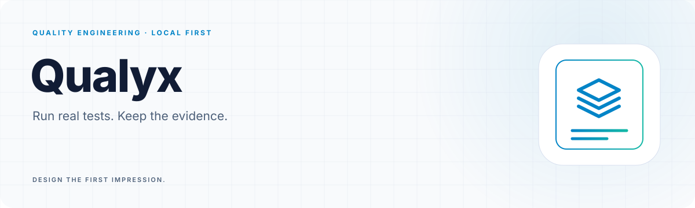
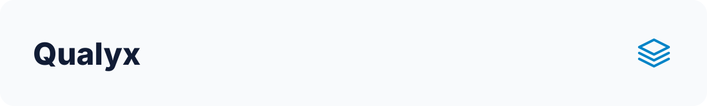

<a id="top"></a>

<!-- Generated by readme-builder; edit the JSON/content source. -->

<p align="center"><picture><source media="(prefers-color-scheme: dark)" srcset="assets/readme-builder/en/hero-dark.svg" /></picture></p>

<p align="center"><strong>Run real tests. Keep the evidence.</strong></p>

<p align="center"><a href="#start"><picture><source media="(prefers-color-scheme: dark)" srcset="assets/readme-builder/kit/btn-run-your-first-check-outline-sm-dark.svg" /></picture></a>&nbsp;
<a href="#evidence"><picture><source media="(prefers-color-scheme: dark)" srcset="assets/readme-builder/kit/btn-results-you-can-inspect-outline-sm-dark.svg" /></picture></a>&nbsp;
<a href="#agents"><picture><source media="(prefers-color-scheme: dark)" srcset="assets/readme-builder/kit/btn-use-it-with-your-agent-outline-sm-dark.svg" /></picture></a></p>

<p align="center"><a href="README.md"><picture><source media="(prefers-color-scheme: dark)" srcset="assets/readme-builder/kit/btn-english-primary-sm-dark.svg" /></picture></a>&nbsp;
<a href="README.es.md"><picture><source media="(prefers-color-scheme: dark)" srcset="assets/readme-builder/kit/btn-espanol-outline-sm-dark.svg" /></picture></a></p>

<a id="start"></a>

##  Run your first check

Qualyx discovers a project's tests, runs its native tools and preserves the evidence. Use it from a terminal, an MCP agent or a shared API. **Deterministic execution needs no AI model.**

M0–M7 are implemented within the [documented scope](docs/STATUS.md). CI validates Windows, Linux and macOS, including real browsers and installation smoke tests.

Install Git and stable Rust, plus the native toolchain for your project:

```sh
git clone https://github.com/robgallardof/qualyx.git
cd qualyx
cargo install --locked --path crates/qualyx-cli
qualyx doctor path/to/project
qualyx discover path/to/project
qualyx test path/to/project
qualyx report path/to/project
```

For a small real example, install Python and pytest, then run `qualyx test fixtures/python/passing`. The companion `fixtures/python/failing` deliberately fails. Tests execute project code: use repositories you trust.

Exit codes: **0** passed · **1** failures · **2** unproven. An empty project is never green. Native archives and checksums are built by the [package workflow](https://github.com/robgallardof/qualyx/actions/workflows/release.yml); this does not imply a published release.

<p align="center"></p>

<a id="evidence"></a>

##  Results you can inspect

Every run writes `.qualyx/runs/<run-id>/`: `manifest.json`, `report.md`, native reports and logs. The manifest records commands, tool versions, commit, exit codes and available test details. `.qualyx/` ignores itself in Git.

```sh
qualyx report path/to/project --list
qualyx report path/to/project --run <run-id> --format json
qualyx report path/to/project --format markdown
```

| Ecosystem | Native runner | Evidence |
|---|---|---|
| Rust | `cargo test` | Individual tests from libtest |
| .NET | `dotnet test` | Individual tests from TRX |
| Node | `npm test` → `node --test` | Individual tests from JUnit |
| Node, other runners | `npm test` | Exit code only, explicitly reported |
| Python | `python -m pytest` | Individual tests from JUnit |

Optional adapters cover [browsers and accessibility](docs/m4/browsers.md), [load and security](docs/m5/assurance.md), and [mutation, contracts and services](docs/m6/quality.md). They require their own tools and permissions; a default run does not execute every adapter.

<p align="center"></p>

<a id="agents"></a>

##  Use it with your agent

Print a configuration, review it, then add it to your client:

```sh
qualyx mcp-config codex --root /absolute/path/to/project
```

The server command is `qualyx mcp --root /absolute/path/to/project`. MCP exposes discovery, execution and evidence to compatible clients. Configuration output does not prove client compatibility: see the [tested client matrix](docs/m2/clients.md) for verified versions and unverified clients, including Claude Code, Codex, Cursor and OpenCode.

AI-assisted features are optional. Keep permissions explicit: running tests executes the project's own code.

<p align="center"></p>

<a id="team"></a>

##  Share execution with your team

Local CLI/MCP uses SQLite by default. Team mode adds an authenticated HTTP API, a read-only dashboard, PostgreSQL jobs, separate workers and optional S3-compatible evidence storage.

| Mode | Use it for | Needs |
|---|---|---|
| Local CLI / MCP | One checkout, local evidence | Native test tools |
| Local API | Up to four concurrent runs | Token and allowed project roots |
| Durable team API | Shared queue, independent workers | PostgreSQL; optional S3 |

The [bilingual team guide](docs/m7/team.md) includes the complete Compose setup, credentials, Python SDK, cancellation, backups and recovery. Start there before deploying `deploy/team/compose.yaml`.

Each worker processes one job at a time. The queue holds at most 64 queued/running jobs. Expired worker leases fail jobs rather than automatically repeating external side effects. A finished job is not necessarily a passing test: inspect `manifest.status`.

**Deployment boundary:** trusted project copies only. The supplied image includes Python/pytest; other toolchains need a custom image. No per-user RBAC, hostile multi-tenant isolation, remote PostgreSQL TLS, HA, signed releases or formal SBOM is claimed. Read [SECURITY.md](SECURITY.md) before remote exposure.

<p align="center"></p>

<a id="develop"></a>

##  Explore and contribute

- [Status](docs/STATUS.md): executed checks, evidence and limits.
- [Planning](docs/PLANNING.md) and [master prompt](docs/MASTER_PROMPT.md): architecture and milestones.
- [Integration matrix](docs/m0/integration-matrix.md), [threat model](docs/m0/threat-model.md) and [decisions](docs/adr/).
- [CONTRIBUTING.md](CONTRIBUTING.md) and [AGENTS.md](AGENTS.md): contribution rules.

End-to-end tests need Rust, .NET 10, Node 24 and Python with pytest. Browser/service suites have additional opt-in requirements. Load, DAST and production targets require explicit permission.

```sh
cargo fmt --all --check
cargo clippy --workspace --all-targets -- -D warnings
cargo test --workspace --locked
```

This README uses [Readme Builder](https://github.com/robgallardof/readme-builder). Edit `readme.json` and `docs/readme/content/`, then follow the [rebuild instructions](docs/readme/README.md).

Dual-licensed under [MIT](LICENSE-MIT) or [Apache-2.0](LICENSE-APACHE), at your option. [README asset notices](docs/readme/THIRD-PARTY-NOTICES.md).

<p align="center"><a href="#top"><picture><source media="(prefers-color-scheme: dark)" srcset="assets/readme-builder/kit/btn-back-to-top-outline-sm-dark.svg" /></picture></a></p>

<!-- readme-builder:signature:start -->
<p align="center"><picture><source media="(prefers-color-scheme: dark)" srcset="assets/readme-builder/en/footer-dark.svg" /></picture></p>
<!-- readme-builder:signature:end -->
